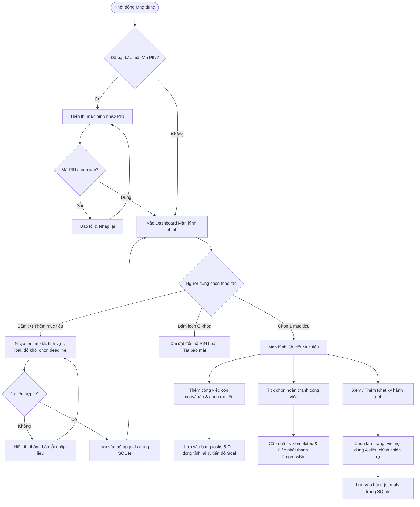

# PHẦN 2 – KẾT QUẢ TỪNG THÀNH VIÊN
## BÁO CÁO KẾT QUẢ CÁ NHÂN: THÀNH VIÊN 1

- **Họ và tên:** Nguyễn Tất Khôi Nguyên
- **Mã sinh viên:** B23DCVT315
- **Chức năng đảm nhiệm chính:** Module Quản Lý Mục Tiêu Cá Nhân, Kế Hoạch Hành Động Ngày/Tuần, Nhật Ký Hành Trình & Bảo Mật Quyền Riêng Tư.

---

### a. Mô tả chi tiết chức năng

#### 1. Thiết lập & Quản lý Mục tiêu cá nhân (Goal Management):
- Cho phép người dùng tạo mới mục tiêu theo phương pháp SMART với các trường thông tin:
  - **Tên mục tiêu:** Ngắn gọn, rõ ràng, định hướng kết quả.
  - **Mô tả chi tiết:** Lý do thực hiện, kết quả kỳ vọng đạt được.
  - **Phân loại lĩnh vực:** Sức khỏe, Công việc, Học tập, Tài chính, Sở thích.
  - **Kỳ hạn mục tiêu:** Ngắn hạn (dưới 1 tháng) hoặc Dài hạn (nhiều tháng/năm).
  - **Độ khó:** Dễ, Trung bình, Khó.
  - **Hạn chót (Deadline):** Ngày dự kiến hoàn thành mục tiêu.
- Quản lý đồng thời nhiều mục tiêu: Lọc tức thì theo từng danh mục lĩnh vực thông qua thanh cuộn ngang ChipGroup; theo dõi tổng số lượng mục tiêu đang quản lý trên Dashboard.
- Xóa mục tiêu: Tích hợp hộp thoại xác nhận (AlertDialog) và cơ chế xóa liên hoàn (Cascade Delete) để xóa sạch các nhiệm vụ con và nhật ký liên quan trong CSDL.

#### 2. Lập kế hoạch hàng ngày / hàng tuần (Action Planning & Task Breakdown):
- Cho phép người dùng chia nhỏ mục tiêu lớn thành các hành động cụ thể.
- Thuộc tính của hành động: Tên việc, chu kỳ thực hiện (Hàng ngày / Hàng tuần), mức độ ưu tiên (Cao / Trung bình / Thấp).
- Đánh dấu hoàn thành: CheckBox tương tác trực tiếp trên danh sách, có hiệu ứng gạch ngang chữ (Strike-through) và đổi màu trạng thái.
- Tự động đồng bộ và tính toán lại phần trăm tiến độ của mục tiêu cha ngay khi trạng thái của hành động thay đổi.

#### 3. Module Ghi chú & Nhật ký hành trình (Notes & Journaling):
- Cho phép ghi chép lại các cột mốc, cảm nghĩ, khó khăn gặp phải trong quá trình thực hiện mục tiêu.
- Đánh giá tâm trạng (Mood Tracker): Tuyệt vời, Tốt, Bình thường, Cần cố gắng.
- Mục "Điều chỉnh chiến lược" (Strategy Adjustment): Khuyến khích người dùng nhìn nhận lại phương pháp và tự điều chỉnh cách làm để đạt hiệu quả cao hơn.

#### 4. Bảo mật & Riêng tư (Security & Privacy):
- Trang bị cơ chế khóa ứng dụng bằng mã PIN 4 chữ số (`SecurityPinActivity`).
- Khi khởi động app, nếu người dùng đã bật bảo mật, hệ thống bắt buộc nhập đúng mã PIN mới cho phép truy cập vào màn hình chính.
- Trong màn hình chính có nút biểu tượng ổ khóa để người dùng có thể đổi mã PIN mới hoặc tắt tính năng bảo mật bất cứ lúc nào.

#### 5. Biểu đồ luồng thực hiện (Activity Diagram)



#### 6. Các ràng buộc nghiệp vụ (Business Rules):
1. **Ràng buộc tên mục tiêu:** Không được phép để trống hoặc chỉ chứa khoảng trắng.
2. **Ràng buộc hạn chót (Deadline):** Không được chọn ngày trong quá khứ so với thời điểm hiện tại (`setMinDate(System.currentTimeMillis())`).
3. **Ràng buộc mã PIN:** Phải đúng định dạng 4 chữ số số học.
4. **Ràng buộc toàn vẹn dữ liệu:** Khi xóa một mục tiêu cha, toàn bộ các nhiệm vụ con (`tasks`) và nhật ký (`journals`) liên thuộc phải được xóa sạch để tránh rác CSDL (Orphaned records).
5. **Ràng buộc tính toán tiến độ:** Tiến độ được tính bằng công thức:  
   $$\text{Progress (\%)} = \left(\frac{\text{Số việc đã hoàn thành}}{\text{Tổng số việc}}\right) \times 100$$  
   Nếu tổng số việc = 0, tiến độ giữ nguyên mức khởi tạo (0%). Khi tiến độ đạt 100%, tự động đánh dấu mục tiêu là đã hoàn thành.

---

### b. Thiết kế giao diện (UI)

Module của Thành viên 1 được xây dựng bằng hệ thống Layout XML chuẩn Material Design hiện đại, màu sắc trang nhã:

1. **Giao diện Dashboard chính (`activity_main.xml`):**
   - Header hiển thị lời chào, số lượng mục tiêu đang quản lý và nút truy cập cài đặt mã PIN.
   - Thanh bộ lọc lĩnh vực cuộn ngang bằng `ChipGroup` (Tất cả, Sức khỏe, Công việc, Học tập, Tài chính, Sở thích).
   - Danh sách mục tiêu dạng thẻ `CardView` bo góc 16dp, đổ bóng nổi bật, kèm thanh `ProgressBar` và chip màu sắc riêng biệt cho từng lĩnh vực.
   - Nút `FloatingActionButton` (+) cố định ở góc dưới cùng bên phải để tạo nhanh mục tiêu.

2. **Giao diện Thiết lập mục tiêu (`activity_add_edit_goal.xml`):**
   - Form cuộn (`ScrollView`) chứa các trường: EditText tên và mô tả, Spinner danh mục, RadioGroup chọn Ngắn hạn / Dài hạn, Spinner độ khó.
   - Nút `OutlinedButton` mở `DatePickerDialog` chọn hạn chót trực quan.
   - Nút bấm to bản "LƯU MỤC TIÊU" màu xanh chủ đạo.

3. **Giao diện Chi tiết mục tiêu & Lập kế hoạch (`activity_goal_detail.xml`):**
   - Card trên cùng hiển thị toàn bộ thông tin chi tiết của mục tiêu, hạn chót và thanh tiến độ thời gian thực.
   - Nút văn bản mở nhanh sang "Nhật Ký & Ghi Chú Hành Trình".
   - Khu vực thêm nhanh nhiệm vụ: EditText nhập tên việc, 2 Spinner chọn lịch (Hàng ngày / Hàng tuần) và độ ưu tiên (Cao / Trung bình / Thấp).
   - Danh sách các công việc (`item_task.xml`) với CheckBox tương tác và nút xóa.

4. **Giao diện Nhật ký hành trình (`activity_journal.xml` & `activity_add_journal.xml`):**
   - Danh sách các bài nhật ký theo dòng thời gian (`item_journal.xml`), hiển thị rõ ngày tháng, tâm trạng và gợi ý điều chỉnh chiến lược.
   - Form viết bài mới với Spinner tâm trạng và các khung nhập liệu rộng rãi.

5. **Giao diện Bảo mật mã PIN (`activity_security_pin.xml`):**
   - Biểu tượng ổ khóa lớn, hướng dẫn nhập liệu rõ ràng.
   - Ô nhập mã PIN 4 số căn giữa, ẩn ký tự (`numberPassword`) với khoảng cách chữ rộng rãi.

---

### c. Giải pháp kỹ thuật để xây dựng chức năng

#### 1. Kiến trúc và Cấu trúc Mã Nguồn:
- **Ngôn ngữ:** Java (Android SDK 34, tương thích từ Android 7.0 / API 24 trở lên).
- **Mô hình kiến trúc:** Mô hình MVC (Model - View - Controller/Activity):
  - `models/`: `Goal.java`, `Task.java`, `Journal.java`.
  - `database/`: `DatabaseHelper.java` kế thừa `SQLiteOpenHelper`.
  - `adapters/`: `GoalAdapter.java`, `TaskAdapter.java`, `JournalAdapter.java` kế thừa `RecyclerView.Adapter`.
  - `activities/`: Các Activity tương ứng quản lý vòng đời và xử lý sự kiện người dùng.

#### 2. Cơ sở dữ liệu SQLite cục bộ:
- Sử dụng SQLite để lưu trữ toàn bộ dữ liệu nội bộ trên máy, đảm bảo tốc độ truy xuất cực nhanh và nguyên tắc **Offline-first** (hoạt động tốt 100% không cần mạng).
- Thiết kế các chỉ mục và câu lệnh truy vấn tối ưu:
  - Lọc theo điều kiện: `SELECT * FROM goals WHERE category = ? ORDER BY id DESC`.
  - Đếm tổng số việc và số việc hoàn thành để tính toán tiến độ:
    ```java
    SELECT COUNT(*) FROM tasks WHERE goal_id = ? AND is_completed = 1
    ```

#### 3. Các điểm mới mà chức năng thực hiện được:
- **Tự động hóa tính toán tiến độ (Real-time Progress Sync):** Không yêu cầu người dùng phải tự kéo thanh phần trăm thủ công. Mọi tiến độ đều được tính toán tự động dựa trên các hành động thực tế đã hoàn thành.
- **Tích hợp Nhật ký điều chỉnh chiến lược:** Không chỉ là một app to-do đơn thuần, ứng dụng cung cấp không gian để người dùng tự phản chiếu (Self-reflection) và linh hoạt thay đổi chiến lược hành động khi gặp khó khăn.
- **Bảo mật quyền riêng tư cục bộ:** Mã PIN bảo vệ thông tin mục tiêu cá nhân, tránh việc người khác cầm vào máy có thể xem được các mục tiêu riêng tư.

#### 4. Các vấn đề khó khăn khi xây dựng chức năng:
- **Quản lý toàn vẹn dữ liệu quan hệ (1-N) trong SQLite thuần:** Do SQLite trên Android mặc định có thể không kích hoạt bật cờ Foreign Key Cascade, nên trong `DatabaseHelper.java`, tôi đã chủ động lập trình hàm `deleteGoal()` xóa thủ công toàn bộ các tasks và journals phụ thuộc trước khi xóa goal cha nhằm đảm bảo không có bản ghi rác.
- **Đồng bộ dữ liệu hai chiều giữa RecyclerView và Activity:** Khi người dùng tick vào CheckBox trong một Item của `TaskAdapter`, làm thế nào để `GoalDetailActivity` nhận được sự kiện và cập nhật lại `ProgressBar` ngay lập tức? Giải pháp là sử dụng mẫu thiết kế **Interface Callback (`OnTaskStatusChangeListener`)** kết nối trực tiếp giữa Adapter và Activity.

---

### d. Các nội dung có thể phát triển tiếp trong tương lai
- Bổ sung tính năng kéo thả (Drag & Drop) để sắp xếp lại thứ tự ưu tiên các mục tiêu và nhiệm vụ.
- Hỗ trợ đính kèm hình ảnh minh chứng hoặc bản thu âm vào từng bài viết nhật ký hành trình.
- Hỗ trợ tính năng xuất (Export) dữ liệu mục tiêu và nhật ký ra file Excel hoặc PDF để lưu trữ cá nhân.
- Tích hợp thêm cảm biến sinh trắc học vân tay (BiometricPrompt API) bên cạnh mã PIN 4 số.
